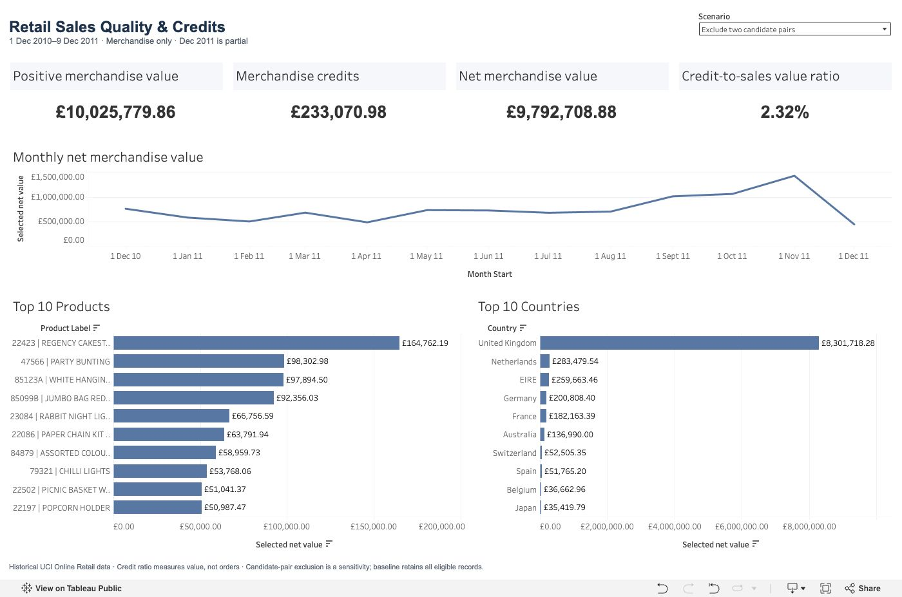

# Retail Sales Quality and Credits

**Python · SQLite · Tableau | Portfolio project by Tanveer Atwal**

An analysis of 541,909 historical retail invoice lines to answer a reporting question: **how much of the recorded credit value is concentrated in unusual transactions, and how does that affect the sales story?**

[Explore the live Tableau dashboard](https://public.tableau.com/views/RetailSalesQuality/RetailSalesQuality) · [Read the findings](reports/findings.md) · [Review the decisions](reports/decision_log.md)

[](https://public.tableau.com/views/RetailSalesQuality/RetailSalesQuality)

## Main findings

The merchandise baseline contains £10.27m in positive value and £478.72k in credits, giving £9.79m in net recorded value. Three credit invoices account for **56.12% of merchandise credit value**. Two have exact candidate sale matches recorded 12 and 16 minutes earlier.

Excluding both sides of those two candidate pairs changes the credit-to-sales value ratio from **4.66% to 2.32%**, while net recorded value stays unchanged. This is a sensitivity test, not an achieved business improvement or proof that the transactions are errors.

| Merchandise measure | Baseline | Exclude two candidate pairs |
| --- | ---: | ---: |
| Positive recorded value | £10,271,433.06 | £10,025,779.86 |
| Credit value, positive magnitude | £478,724.18 | £233,070.98 |
| Net recorded value | £9,792,708.88 | £9,792,708.88 |
| Credit-to-sales value ratio | 4.66% | 2.32% |
| Retained invoice lines | 536,465 | 536,461 |

The UK contributes **84.77% of net merchandise value**. November 2011 is the strongest complete month at **£1,432,734.99**. December 2011 ends on 9 December and should not be compared with a complete month as evidence of a sales decline.

## What I built

- **Python preparation and audit:** preserved identifiers and source rows; checked missing values, possible repeats, signs, dates and exceptional transactions.
- **SQLite analysis:** CASE classifications, CTEs, joins and window functions to reconcile categories, rank credit invoices, identify candidate sale matches and produce monthly/product/country summaries.
- **Independent reconciliation:** SQL results compared with Python aggregations before exporting Tableau data.
- **Published Tableau dashboard:** four KPIs, a continuous monthly trend, top-ten product and country rankings, and a baseline/sensitivity selector.

The dashboard presents the full period and all countries. It has a scenario parameter rather than date or country filter controls. It uses a fixed desktop layout; a phone-specific layout has not been validated.

## Reporting decisions

**Grain and scope.** One source row is an invoice line, not an order. The dashboard uses 536,465 eligible merchandise lines from 541,909 source lines. Delivery, fees, commissions, manual entries, discounts, samples, gift vouchers and bad-debt adjustments are separated. Classification is a documented working rule, not a verified product taxonomy.

**Credits.** Eligible C-prefixed, negative-quantity records with positive unit prices contribute to credit value. Credit-to-sales value ratio is credit magnitude divided by positive merchandise value; it is not an order cancellation rate. Net recorded value is positive value minus credits and is not profit.

**Possible duplicates.** Baseline retains repeated records because identical fields do not prove accidental duplication. Excluding all 5,268 possible repeated source rows changes the broader recorded net value by £21,740.98; this separate audit check is documented rather than silently applied.

**Missing customers.** All 135,080 lines without CustomerID are retained for value reporting where otherwise eligible. Customer-specific measures require known IDs.

**Candidate pairs.** The sensitivity removes four source rows: two positive lines and their two exact candidate credits. Matches use known customer, stock code, unit price, opposite quantity and prior sale date. The source has no explicit sale-to-credit reference, so the relationship and reason remain unconfirmed. Raw records and baseline are preserved.

**Product labels.** Aggregation uses StockCode. Display descriptions are selected consistently from observed descriptions and are not verified canonical names.

## Recommended follow-up

Before changing a business KPI, ask the transaction owner to confirm the two candidate reversals and the large April credit. Report the baseline alongside the sensitivity until that evidence is available. Keep December 2011 marked as partial, and investigate the UK's credit concentration using transaction records rather than inferring causes from country totals alone.

## Validation

Python and SQL agree to the penny on all 21 category/value comparisons, monthly measures, and complete product and country summaries (3,922 stock codes and 38 countries). Export checks cover identifier preservation, row counts and the CSV round trip. Both published scenarios were visually checked on 18 October 2026; their KPIs agree with the table above.

[Validation metadata](reports/tableau_export_checks.json) · [Dashboard verification](reports/dashboard_verification.md)



## Reproduce the analysis

Use Python 3 and install `requirements.txt`. Download the workbook or ZIP from [UCI Online Retail](https://archive.ics.uci.edu/dataset/352/online%2Bretail), then place `Online Retail.xlsx` or `online_retail.zip` in `data/raw/`.

Run from the project root:

```bash
python -m pip install -r requirements.txt
python scripts/prepare_data.py
python scripts/validate_segment_summaries.py
python scripts/export_tableau_data.py
```

The scripts preserve the raw source and rebuild staging CSV, SQLite database, dashboard CSV and supporting summaries. They do not download data. Raw and generated data are excluded from Git by default. Connect Tableau to the single line-level `data/processed/tableau_merchandise.csv`; do not join the aggregate reference CSVs onto it.

The checked SQL is in `sql/01_raw_inspection.sql` through `sql/08_country_summary.sql`. The completed audit notebook, `notebooks/01_data_audit.ipynb`, contains the Python investigation and SQL results. Reproducible preparation and cross-checks are also available as scripts.

```text
scripts/prepare_data.py                  Source checks, CSV and SQLite staging
scripts/validate_segment_summaries.py    Independent Python/SQL comparison
scripts/export_tableau_data.py          Monthly checks and dashboard export
sql/                                    Audit, reconciliation and analysis
reports/findings.md                     Findings and recommendations
reports/decision_log.md                 Analytical decisions
reports/images/                         Published dashboard screenshots
tableau/BUILD_GUIDE.md                   Calculations and build instructions
tableau/Retail Sales Quality.twbx        Packaged dashboard with embedded extract
```

Download [the packaged Tableau workbook](tableau/Retail%20Sales%20Quality.twbx) to inspect the dashboard locally. It contains the validated merchandise Hyper extract and uses relative paths. The original workbook, staging database and large CSVs are excluded; the packaged dashboard is the deliberate exception for convenient review. To refresh from source, rebuild the CSV and replace the workbook data connection as described in the build guide. The live dashboard requires no setup.

To work interactively, optionally install JupyterLab (`python -m pip install jupyterlab`) and open `notebooks/01_data_audit.ipynb`. Core scripts only require the packages in `requirements.txt`.

## Source and limitations

Chen, D. (2015). *Online Retail*. UCI Machine Learning Repository. [DOI: 10.24432/C5BW33](https://doi.org/10.24432/C5BW33). Dataset licence: [CC BY 4.0](https://creativecommons.org/licenses/by/4.0/).

Coverage: 1 December 2010 to 9 December 2011. These historical transactions cannot establish current market conditions, causes or stable seasonality. This is a personal learning project developed with guided assistance, not employment or commissioned work for the retailer.
